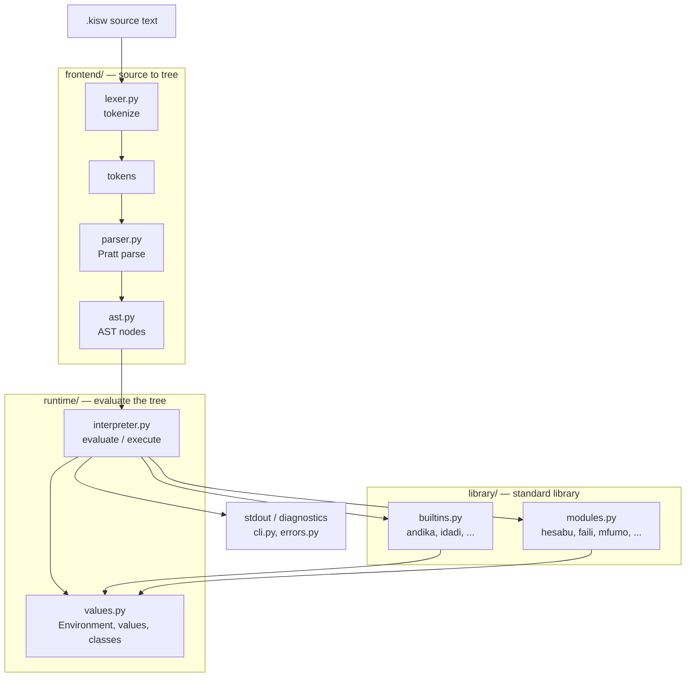
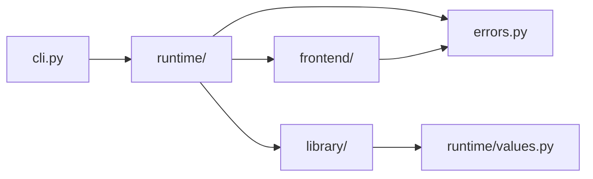

# Architecture

Kiswahili is a classic tree-walking interpreter. Source text flows through
four stages, and the package is organised to match them.

## Folder map

| Folder / file | Responsibility |
|---------------|----------------|
| `swahili/frontend/` | turn text into an AST; no execution |
| `swahili/frontend/lexer.py` | characters → tokens, strings, f-strings, indentation-free newlines |
| `swahili/frontend/parser.py` | tokens → AST; statements, expressions, precedence |
| `swahili/frontend/ast.py` | dataclass definitions for every syntax node |
| `swahili/runtime/` | everything about running a program |
| `swahili/runtime/values.py` | `Environment`, functions, classes, instances, modules, formatting |
| `swahili/runtime/interpreter.py` | the evaluator; dispatch tables; scopes; calls |
| `swahili/library/` | the standard library |
| `swahili/library/builtins.py` | globals (`andika`, `idadi`, …) and value methods |
| `swahili/library/modules.py` | importable modules (`hesabu`, `faili`, …) |
| `swahili/errors.py` | bilingual error types and rendering |
| `swahili/cli.py` | argument parsing, file runner, REPL |
| `swahili/__init__.py` | public API: `Interpreter`, `parse`, `tokenize`, errors |
| `examples/` | runnable sample programs |
| `tests/` | `unittest` suite |
| `docs/` | language reference, tutorial, security |
| `docs/security/` | threat model and sandbox guidance |

## Dependency direction

Dependencies point **inward and downward**:

`runtime/interpreter.py` imports `library/`, and `library/` imports
`runtime/values.py`. The only shared link is `values.py`, so there is no
import cycle at module level.

Rules of thumb:

- `frontend` never imports `runtime` or `library`.
- `library` depends on `runtime` values, never on `cli`.
- `runtime/interpreter.py` is the only place that wires frontend, library, and
  values together.
- `errors.py` is shared and imports nothing from the package.

## Adding a feature

- **New syntax:** add a node in `frontend/ast.py`, parse it in
  `frontend/parser.py`, evaluate/execute it in `runtime/interpreter.py`, and
  add tests.
- **New built-in function:** add it in `library/builtins.py` and register it in
  `install()`.
- **New importable module:** add a factory in `library/modules.py` and list it
  in `MODULES`.
- **Changed behaviour:** update `docs/spec.md`, and re-check
  `docs/security/threat-model.md` if the change touches the host.

## Execution model

- Every scope is an `Environment` with a parent link.
- User functions capture their defining `Environment`, which gives closures.
- Classes collect methods in a private `Environment`; instances carry fields.
- The interpreter has a `MAX_DEPTH` guard (200) shared across calls.
- Errors are Python exceptions carrying bilingual messages; the CLI renders
  them with the source line and a caret.
