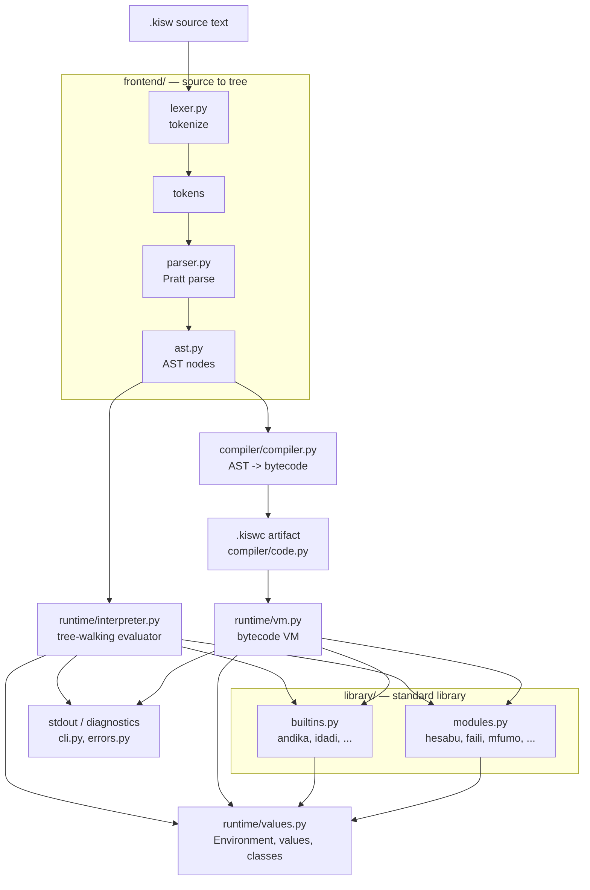
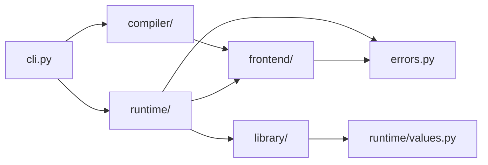

# Architecture

Kiswahili has one frontend and two execution engines. Source text flows
through the lexer and parser into an AST. From there it can be evaluated
directly by the tree-walking reference interpreter, or lowered to bytecode and
executed by the virtual machine.

## Folder map

| Folder / file | Responsibility |
|---------------|----------------|
| `swahili/frontend/` | turn text into an AST; no execution |
| `swahili/frontend/lexer.py` | characters → tokens, strings, f-strings, newline rules |
| `swahili/frontend/parser.py` | tokens → AST; statements, expressions, precedence |
| `swahili/frontend/ast.py` | dataclass definitions for every syntax node |
| `swahili/compiler/` | lower an AST to bytecode and serialize artifacts |
| `swahili/compiler/opcode.py` | instruction set and operand metadata |
| `swahili/compiler/code.py` | `CodeObject`, `Artifact`, function/class specs, disassembler |
| `swahili/compiler/compiler.py` | AST → code objects, including nested scopes |
| `swahili/runtime/` | everything about running a program |
| `swahili/runtime/values.py` | `Environment`, functions, classes, instances, modules, formatting |
| `swahili/runtime/interpreter.py` | tree-walking reference evaluator |
| `swahili/runtime/vm.py` | stack-based bytecode VM with call frames and block stack |
| `swahili/runtime/semantics.py` | coercion/comparison rules shared with the VM |
| `swahili/library/` | the standard library |
| `swahili/library/builtins.py` | globals (`andika`, `idadi`, …) and value methods |
| `swahili/library/modules.py` | importable modules (`hesabu`, `faili`, …) |
| `swahili/errors.py` | bilingual error types and rendering |
| `swahili/cli.py` | argument parsing, file runner, compiler flags, REPL |
| `swahili/__init__.py` | public API: `Interpreter`, `VM`, `compile_source`, `Artifact` |
| `examples/` | runnable sample programs |
| `tests/` | `unittest` suite, including interpreter/VM parity tests |
| `docs/` | language reference, tutorial, security |
| `docs/security/` | threat model and sandbox guidance |

## Bytecode model

- Instructions are small: `LOAD_CONST`, `LOAD_NAME`, `BINARY_OP`, `CALL_FUNCTION`,
  jumps, `SETUP_LOOP`, `SETUP_TRY`, and so on. Each instruction carries the
  line, column and source index of the AST node that produced it.
- Constants, including nested `FunctionSpec` and `ClassSpec` values, live in a
  code object's constant table.
- The compiler recursively emits a separate code object per function, lambda,
  class body, default expression, and module.
- The VM has an explicit value stack, call frames, and a block stack for loops,
  `jaribu/kosa/mwisho`, `rudia`, `vunja`, and `endelea`.
- `.kiswc` artifacts are zlib-compressed JSON in a small binary envelope with a
  magic header and version. They carry the original source text and its SHA-256
  hash, so compiled programs still produce caret diagnostics and stale/corrupt
  artifacts are rejected or recompiled. Version 1 text artifacts are migrated
  on load.
- Imported modules are compiled once to sibling `.kiswc` caches by the VM; the
  cache is used only while the source hash matches.
- Both engines share `values.py`, the builtins, modules, resource budgets, and
  sandbox rules. The reference interpreter is kept as the semantic oracle.

## Dependency direction

Dependencies point **inward and downward**:

Rules of thumb:

- `frontend` never imports `runtime`, `compiler`, or `library`.
- `compiler` depends only on `frontend` and its own code/artifact types.
- `library` depends on `runtime` values, never on `cli`.
- Both `runtime/interpreter.py` and `runtime/vm.py` wire frontend, library,
  and values together. The VM additionally imports `compiler/` code objects.
- `errors.py` imports nothing from the package.

## Adding a feature

- **New syntax:** add a node in `frontend/ast.py`, parse it in
  `frontend/parser.py`, evaluate it in `runtime/interpreter.py`, compile it in
  `compiler/compiler.py`, execute it in `runtime/vm.py`, and add a parity test.
- **New opcode:** add it to `compiler/opcode.py`, emit it in
  `compiler/compiler.py`, handle it in `runtime/vm.py`, and extend the
  disassembler where useful.
- **New built-in function:** add it in `library/builtins.py` and register it in
  `install()`.
- **New importable module:** add a factory in `library/modules.py` and list it
  in `MODULES`.
- **Changed behaviour:** update `docs/spec.md`, and re-check
  `docs/security/threat-model.md` if the change touches the host.

## Execution model

- Every scope is an `Environment` with a parent link.
- User functions capture their defining `Environment`, which gives closures.
- Classes collect methods in a private `Environment`; instances carry fields.
- Both engines enforce `MAX_DEPTH` (200) across calls.
- Errors are Python exceptions carrying bilingual messages; the CLI renders
  them with the source line and a caret.
