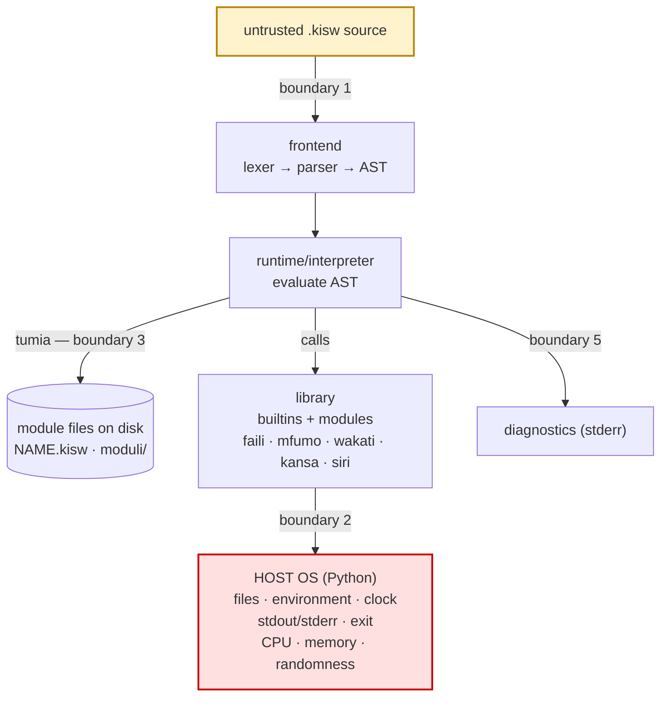

# Kiswahili Threat Model

Status: initial model (v0.1). Review whenever a new built-in, module, or host
capability is added.

This document asks one question throughout: **if a hostile `.kisw` program, a
hostile module file, or a hostile working directory is handed to the
interpreter, what can go wrong, and what do we do about it?**

## 1. Executive summary

Kiswahili is an interpreter. Running a `.kisw` file is, by construction,
running code with the full privileges of the Python process that hosts the
interpreter. The language is not currently sandboxed and the standard library
exposes the host filesystem, environment variables, process exit, and
unbounded CPU/memory operations.

That means, for untrusted input, **the current design is vulnerable by
design** — not because of a coding mistake, but because no capability boundary
exists between a program and the host. A language can still be *secure by
design* if it adopts **least privilege and explicit capabilities**: computation
by default, host access only when the operator grants it.

The single most important rule today:

> Never run an untrusted `.kisw` file or untrusted module on a machine you
> care about without an OS-level sandbox and a non-privileged account.

Section 9 lists the concrete hardening roadmap that moves the project from
"vulnerable by design" toward "secure by design".

## 2. Scope and assumptions

In scope:

- the lexer, parser, and tree-walking interpreter;
- the global built-ins and value methods (`andika`, `ondoa`, `pangamiza`, …);
- the standard-library modules (`hesabu`, `orodha_kazi`, `maneno_kazi`,
  `kansa`, `siri`, `wakati`, `mfumo`, `faili`);
- module resolution (`tumia`);
- the CLI and REPL;
- packaging and distribution (`pyproject.toml`).

Out of scope for v0.1 (but noted for the future):

- a network module (none exists today);
- concurrency/threads;
- native extensions;
- a package registry.

Assumptions:

- The operator controls the machine and the Python installation.
- Programs are either written by the operator (trusted) or obtained from
  somewhere else (untrusted).
- The operating system provides accounts, file permissions, and (optionally)
  containers or sandboxes.

## 3. Assets

| Asset | Why it matters |
|-------|----------------|
| Host filesystem | read, modification, deletion of user data and code |
| Environment variables | API keys, tokens, cloud credentials, paths |
| Process availability | CPU, memory, time, file descriptors |
| Integrity of user data | accidental or malicious overwrite/delete |
| Confidential source/data | source lines and data echoed in diagnostics |
| Developer/CI machine | credentials and build integrity |
| Distribution channel | users trust the package they install |
| Reputation of the project | a single incident can end adoption |

## 4. Actors

| Actor | Trust | Notes |
|-------|-------|-------|
| Program author | trusted or untrusted | writes `.kisw` code |
| Operator | trusted | runs the interpreter |
| Local attacker | untrusted | controls CWD, writable module folders, env |
| Malicious module author | untrusted | ships a `.kisw` that gets imported |
| Supply-chain attacker | untrusted | tampers with the package or build |
| Accidental author | trusted | simply makes a destructive mistake |

## 5. Trust boundaries and data flow

Boundaries:

1. **Source → interpreter.** Untrusted text is tokenized and parsed.
2. **Interpreter → host.** Any built-in or module may cross into the
   filesystem, environment, clock, or process control.
3. **Module resolution → filesystem.** `tumia` resolves names to files on disk
   before falling back to built-ins.
4. **Distribution → build/install.** Installing the package executes a build
   backend.
5. **Diagnostics → logs.** Errors may carry source lines and paths.

Boundary 4 (distribution → build/install) happens before this runtime flow; it
is covered by T13 and T14.

## 6. Threat catalog (STRIDE)

Risk = likelihood × impact, rated Critical / High / Medium / Low for the
current default configuration.

### T1 — Arbitrary file read, write, append, delete (Critical)

- **Boundary:** interpreter → host, via `faili`.
- **Evidence:** `library/modules.py` `_soma`, `_andika`, `_mistari`,
  `_futa`, `_tengeneza` call `open`, `os.remove` with program-supplied paths.
- **Impact:** read secrets, overwrite configuration or code, delete data,
  write to startup files / scripts (persistence).
- **Mitigation (design):** capability-based filesystem access
  (`--allow-fs=DIR`), path confinement (resolve and verify under allowed
  roots), default deny when running untrusted programs. The current
  `--sandbox` flag already refuses the `faili` module outright.
- **Mitigation (implemented):** `--allow-fs DIR` (repeatable) grants `faili`
  only inside the given roots; every path is passed through
  `os.path.realpath` and checked before `open`/`os.remove`, which also blocks
  `..` and symlink escapes. Without `--allow-fs`, `--sandbox` denies `faili`.
- **Mitigation (now):** run untrusted programs as a low-privileged user in a
  container or OS sandbox.

### T2 — Environment secret disclosure (High)

- **Boundary:** interpreter → host, via `mfumo.mazingira`.
- **Evidence:** `library/modules.py` returns `os.environ.get(name)`.
- **Impact:** exfiltration of API keys and cloud credentials by source code
  that also exfiltrates through `faili` or stdout.
- **Mitigation:** capability flag; scrub the environment passed to child
  interpreters; document that `mfumo` is privileged. The `--sandbox` flag
  already refuses the `mfumo` module.

### T3 — Untrusted program is arbitrary code execution (Critical, inherent)

- **Boundary:** operator → interpreter.
- **Impact:** everything the hosting user can do.
- **Mitigation:** treat `.kisw` like any executable; never run untrusted code
  un-sandboxed. Provide a documented sandbox runner (container, Windows
  AppContainer / low-integrity token, macOS sandbox profile, `firejail`).

### T4 — Module shadowing / search-path hijack (High) — mitigated

- **Boundary:** module resolution → filesystem.
- **Evidence (historical):** `runtime/interpreter.py` `load_module` checked
  for a local `<name>.kisw` *before* the built-in module, and `_find_file`
  searched `self.search_paths`, then **`os.getcwd()`**, then `moduli/`
  subfolders.
- **Impact:** a file named `hesabu.kisw` placed in the working directory or in
  a writable module folder replaces the trusted standard module. A malicious
  CWD (e.g., an extracted archive) silently hijacks imports.
- **Mitigation (implemented):** `load_module` now resolves built-ins first;
  `_find_file` searches only the program directory and explicit `--path`
  entries (no CWD). A local file can no longer shadow a standard module, and
  local modules must be opted into with `--path`.
- **Remaining:** emit a warning when a local file has a built-in name, and
  support signed/explicit module overrides if ever needed.

### T5 — Denial of service through unbounded execution (High)

- **Boundary:** interpreter → host resources.
- **Evidence:** `wakati { }` loops have no budget; `wakati.sekunde(s)` sleeps
  arbitrarily; recursion is capped at 200 but loops are not.
- **Impact:** a program that never terminates pins a core or hangs CI.
- **Mitigation (implemented):** statement/step budget (`--max-steps`, default
  10,000,000) and printed-output cap (`--max-output`, default 10,000,000).
  Remaining: wall-clock timeout for file runs and OS resource limits.
- **Mitigation (now):** OS-level CPU and time limits.

### T6 — Memory exhaustion (High)

- **Boundary:** interpreter → host resources.
- **Evidence:** `2 ** 100000000` (Python big integers), `"a" * 100000000`,
  `kipeano(n)` builds `list(range(int(n)))`, list repetition, and large
  literals.
- **Impact:** OOM kills the process or the machine.
- **Mitigation (implemented):** range size, string/list repetition, `kipeano`,
  and exponent magnitude/bits are capped (`--max-collection`, default
  1,000,000; exponent ≤ 1,000,000 and result ≤ 8,000,000 bits). Remaining:
  per-process memory limits and catching `MemoryError` cleanly.
- **Mitigation (now):** run under an OS memory limit.

### T7 — Parser/lexer stack exhaustion (Medium)

- **Boundary:** source → interpreter.
- **Evidence:** recursive-descent parser and recursive expression grammar on
  deeply nested input.
- **Impact:** `RecursionError` or crash on hostile input.
- **Mitigation (now):** explicit nesting-depth limit of 64 in statements,
  expressions, and unary operators, raising a clean bilingual `Kosa`; fuzz the
  parser and raise the Python recursion budget only as a stop-gap. **Limit
  done; fuzzing remains.**

### T8 — Information disclosure in diagnostics (Low–Medium)

- **Boundary:** diagnostics → logs/terminals.
- **Evidence:** `errors.py` renders the offending source line and a caret;
  messages include file paths and module search paths.
- **Impact:** secrets embedded in source or data can be copied into CI logs.
- **Mitigation:** a redaction mode; never log full source in shared CI; keep
  diagnostics on stderr only.

### T9 — Non-cryptographic randomness (Medium)

- **Boundary:** `kansa` module.
- **Evidence:** uses Python's `random` (Mersenne Twister).
- **Impact:** predictable values if used for tokens, passwords, keys, or
  nonces.
- **Mitigation (implemented):** `kansa` is documented as “not for security”
  and a separate `siri` module provides `tokeni`, `baiti`, `namba`, `chagua`,
  and constant-time `linganisha` backed by Python's `secrets`.

### T10 — Destructive default: overwrite and delete (Medium)

- **Boundary:** interpreter → host, via `faili`.
- **Evidence:** `andika` opens with mode `"w"` unless `append=True`, and
  `futa` calls `os.remove` with no confirmation.
- **Impact:** an accidental or malicious call silently destroys data.
- **Mitigation:** safe defaults (append or refuse to overwrite unless
  `overwrite=True`), confirmation for deletion, backup-on-write option.

### T11 — Path traversal and symlink following (Medium)

- **Boundary:** interpreter → host, via `faili` and `mfumo`.
- **Evidence:** paths are used as given; symlinks are followed; `orodha(p)`
  lists any directory.
- **Impact:** escape from an intended working directory; read/list outside a
  project; write through a symlink to a sensitive target.
- **Mitigation (implemented for `faili`):** `--allow-fs` confines to allowed
  roots after `realpath` resolution, rejecting `..` and symlink escapes.
  `mfumo` directory listing remains unconfined and is blocked wholesale under
  `--sandbox`; per-path confinement for `mfumo` is still future work.

### T12 — Host reconnaissance (Low)

- **Boundary:** interpreter → host, via `mfumo`.
- **Evidence:** `folda`, `orodha`, `mfumo` (platform), `python` (version).
- **Impact:** fingerprinting to tailor further attacks.
- **Mitigation:** capability-gate `mfumo`; return minimal information by
  default.

### T13 — Supply-chain and dependency confusion (Medium)

- **Boundary:** distribution → build/install.
- **Evidence:** `pyproject.toml` has no runtime dependencies (good) but a
  floating `setuptools>=61` build requirement; no lockfile or signed
  releases yet.
- **Impact:** a compromised build backend or a typosquatted package name
  executes during install.
- **Mitigation:** pin/verify build requirements, produce an SBOM, sign
  releases, use trusted publishing and 2FA, document verification steps.

### T14 — Distribution tampering of `.kisw` code (High)

- **Boundary:** operator → downloaded program.
- **Evidence:** examples and modules are plain source with no signatures or
  checksums.
- **Impact:** a tampered example or module runs with user privileges.
- **Mitigation:** publish checksums/signatures, encourage review, run
  untrusted code in the sandbox, keep examples read-only in the repo.

### T15 — Unicode and homoglyph confusion (Medium, future)

- **Boundary:** source → lexer.
- **Impact:** visually similar identifiers or look-alike keywords could spoof
  code in review or logs.
- **Mitigation:** define and enforce the identifier character set (ASCII or a
  documented Unicode range), normalize input, warn on mixed scripts.

### T16 — Operational confusion in the REPL (Low)

- **Boundary:** operator → REPL.
- **Evidence:** the alias table maps `ondoa` to *exit* in the REPL, while the
  `ondoa` built-in means *input* in programs, and `msaada` clears all
  variables.
- **Impact:** unexpected exit or loss of REPL state; not a remote threat.
- **Mitigation:** rename or disambiguate REPL commands; confirm destructive
  actions.

## 7. Attack scenarios

**Scenario A — malicious example.** A user clones an untrusted repository and
runs `python -m swahili game.kisw`. The program reads `~/.ssh/id_rsa` with
`faili.soma`, reads `AWS_SECRET_ACCESS_KEY` with `mfumo.mazingira`, and writes
the result to a file or prints it. → T1, T2, T3.

**Scenario B — hijacked import.** A user extracts an archive and runs a script
from it. The archive contains `hesabu.kisw`, which is imported instead of the
trusted built-in. → T4.

**Scenario C — resource exhaustion.** A downloaded script runs
`wakati kweli { }` or `2 ** 100000000`. CI hangs or the runner runs out of
memory. → T5, T6.

**Scenario D — data loss.** A script calls `faili.andika("config.json", "")`
and truncates a user file. → T10.

**Scenario E — log leakage.** A program fails and CI stores stderr, including a
source line containing a secret parsed from the environment. → T8, T2.

## 8. Current security posture

| Control | State |
|---------|-------|
| Sandbox between program and host | **partial** (`--sandbox` blocks `faili`/`mfumo`; no OS isolation) |
| Capability/allow-list for filesystem | **partial** (`--allow-fs DIR`, realpath confinement) |
| Capability/allow-list for environment | **absent** |
| Module resolution hardening | **present** (built-ins first; CWD not searched; explicit `--path`) |
| Execution time / step budget | **present** (statement budget `--max-steps`, default 10,000,000; output cap `--max-output`, default 10,000,000; wall-clock timeout pending) |
| Memory / size limits | **present** (collection/repetition/range/exponent size caps `--max-collection`, default 1,000,000; exponent bounds default; wall-clock timeout pending) |
| Parser nesting limit | **present** (64 levels; clean bilingual error) |
| Recursion limit (language) | present (200) |
| No Python `eval`/`exec` of program text | **present** (good) |
| No `subprocess` / shell execution | **present** (good) |
| No network capability | **present** (good) |
| Non-crypto randomness documented | **present** (`kansa` vs `siri`) |
| Dependency footprint | **minimal** (no runtime deps) |
| Security policy / disclosure channel | added with this document |

## 9. Hardening roadmap (secure by design)

Priority order. Each item is a design change, not a patch.

1. **Sandbox documentation + runner.** Ship a `docs/security/sandbox.md` with
   container and OS-specific recipes, and expand the `--sandbox` profile
   (already blocks `faili` and `mfumo`) with OS-level isolation guidance and
   optional capability grants. **Done.**
2. **Capabilities.** Add operator flags such as
   `--allow-fs=DIR` (repeatable), `--allow-env=NAME`, `--allow-exit`, and
   make privileged modules fail closed unless granted. **`--allow-fs` done;
   `--allow-env` and `--allow-exit` remain.**
3. **Path confinement.** Resolve with `realpath`, reject symlink escapes,
   confine to allowed roots. **Done for `faili`; `mfumo` still open.**
4. **Deterministic module resolution.** Built-ins first; opt-in local
   modules; remove CWD from the default path; warn on shadowing.
   **Done (warning not yet emitted).**
5. **Resource budgets.** Step limit, wall-clock timeout, output cap, memory
   cap, and size limits for exponentiation, repetition, ranges, and
   collections. **Done for steps/output/collections/sizes; wall-clock timeout
   remains.**
6. **Parser/lexer robustness.** Explicit nesting depth limit; fuzzing.
   **Limit done (64); fuzzing remains.**
7. **Safe file defaults.** Append/no-overwrite by default; confirmation for
   `futa`; optional backup.
8. **Crypto module.** Add `siri` using `secrets`; mark `kansa` as
   non-security. **Done.**
9. **Supply chain.** Pin build dependencies, lockfile, SBOM, signed releases,
   trusted publishing.
10. **Diagnostics hygiene.** Redaction option and guidance for CI logs.
11. **Security tests.** Add tests asserting that privileged modules are
    denied under a sandbox profile, that module shadowing is prevented, and
    that size limits trigger clean errors. **Sandbox, shadowing, CWD, and
    `--allow-fs` escape tests done; size-limit tests pending item 5.**
12. **Regular review.** Re-run this threat model whenever a capability is
    added; keep a lightweight risk register in the issue tracker.

## 10. Secure-by-design invariants

These are the rules future changes should preserve:

- **No host execution from data.** Never call Python `eval`/`exec` on program
  text or user data.
- **No shell.** Do not add `subprocess`/shell execution without an explicit
  capability and a documented threat update.
- **Deny by default.** New privileged abilities must be opt-in.
- **Least privilege.** A program should only touch the files, environment,
  and time it was granted.
- **Fail closed and fail safe.** Errors must not leak secrets or execute
  fallbacks.
- **Bounded resources.** Every unbounded primitive needs a cap or a budget.
- **Deterministic resolution.** Module and file resolution must not depend on
  an attacker-controlled working directory.
- **Trust the source you run.** Document that `.kisw` is executable code.
